**Table of contents**

- [From static batches to iteration-level scheduling](#from-static-batches-to-iteration-level-scheduling)
- [The scheduler's job on every tick](#the-schedulers-job-on-every-tick)
- [Chunked prefill](#chunked-prefill)
- [Lesson 1: a limit you configure is not a limit you enforce](#lesson-1-a-limit-you-configure-is-not-a-limit-you-enforce)
- [Lesson 2: decode first](#lesson-2-decode-first)
- [Lesson 3: padding turns 0.1 s into 3.6 s](#lesson-3-padding-turns-01-s-into-36-s)
- [The rule today: phase-homogeneous, alternating steps](#the-rule-today-phase-homogeneous-alternating-steps)
- [Which request goes next: scheduling policies](#which-request-goes-next-scheduling-policies)
- [Cancellation at step boundaries](#cancellation-at-step-boundaries)
- [Takeaways](#takeaways)
- [Acknowledgments](#acknowledgments)

[Post 2](2026-11-22-inference-101-prefill-decode.md) argued that batching
decode is nearly free because decode is memory-bound. This post is about
collecting that free throughput without wrecking latency. Most of it is told
through mistakes, because the mistakes taught us more than the design did.

## From static batches to iteration-level scheduling

**Static batching** collects N requests, runs them together until the
longest finishes, then takes the next N. Requests that finish early leave
their slot empty, and new arrivals wait for the whole batch.

**Continuous batching**, introduced by Orca as *iteration-level scheduling*,
makes the scheduling decision once per model step instead of once per batch.
A request joins as soon as there is room and leaves as soon as it stops. The
batch is a set of rows that changes every step.

```mermaid
gantt
    dateFormat X
    axisFormat %s
    section Static
    A (long)   :0, 8
    B (short)  :0, 3
    C waits    :8, 12
    section Continuous
    A (long)   :0, 8
    B (short)  :0, 3
    C joins    :3, 7
```



*Figure 1: With static batching, C waits for A even though B left at step 3.
With continuous batching, C takes B's slot at step 3.*

MLX Air's native backend has a long-lived scheduler
(`NativeContinuousScheduler` in `python/mlx_worker/native_mlx/scheduler.py`)
that owns every accepted request and an executor whose only interface is one
model step:

```text
ExecutionBatch -> StepResult
```

The executor never runs a whole request. The scheduler decides which rows go
into each step and what each row contributes: one token for a decoding
request, or a slice of the prompt for a prefilling one.

## The scheduler's job on every tick

Each tick, the scheduler:

1. reaps cancelled and finished requests and releases their pages;
2. decides the next step's work (decode rows, prefill chunks, or both);
3. admits waiting requests whose KV reservation fits
   ([post 3](2026-11-22-paged-kv-cache-unified-memory.md));
4. runs the step;
5. turns results into events: a new token, a finished request, an error.

Steps 2 and 3 are where the interesting policy lives.

## Chunked prefill

A 2,000-token prompt prefilled in one pass takes hundreds of milliseconds on
a laptop GPU. If that pass runs as one step, every other request's next token
waits for it. Users see this as a stream that freezes whenever someone else
sends a long prompt.

**Chunked prefill** splits the prompt into fixed-size pieces, 256 tokens by
default (`MLX_RUNTIME_TEXT_PREFILL_CHUNK_SIZE`). Each chunk writes its K/V to
the cache and the next chunk resumes from there, so nothing is recomputed.
Between chunks, the scheduler can run a decode step for everyone else.

Chunk size trades one thing for another. Bigger chunks finish the new
request's prefill in fewer steps and use the GPU more efficiently. Smaller
chunks let decode steps in more often. In an early version of the scheduler,
which still mixed decode rows into prefill steps, raising the chunk from 16
to 64 tokens improved single-request rows but pushed the mean latency of a
"few long prompts plus many short prompts" streaming workload to 3,349 ms,
against 1,382 ms for the `v1` backend. Bigger chunks were the wrong trade for
tail latency there. As we will see, the real problem was elsewhere.

## Lesson 1: a limit you configure is not a limit you enforce

The worker accepted a `text_prompt_concurrency` setting: how many requests may
prefill in the same step. The native scheduler read the setting and then
ignored it. Every waiting prompt entered one physical prefill step.

The symptom was confusing. Short requests got an *early* first token, which
looked great on a TTFT chart. But their second token waited behind the long
prompts' chunks in every following step. Per-request timing, not aggregate
means, made it visible.

The fix wires `text_prompt_concurrency` into the scheduler's
`prefill_batch_size` and adds deterministic scheduler tests that it is
respected. The general lesson: every configuration value should have a test
that observes its effect, not just a test that parses it.

## Lesson 2: decode first

Even with prefill width bounded, per-request timelines still showed running
requests' tokens delayed behind new prompts' chunks. The scheduler now
**prioritizes decode**: when any request is decoding, a prefill step admits
at most one chunk (`prefill_limit = 1 if decode_waiting`). New prompts still
make progress, but a running stream never waits for several of them.

On that version of the engine, the change brought the mixed streaming
workloads ahead of `v1` on the same checkpoint and gateway (mean latency,
lower is better):

| Workload | `v1` | native, decode first |
| --- | ---: | ---: |
| few long + many short prompts, concurrent | 1,444.8 ms | 1,065.5 ms |
| few short + many long prompts, concurrent | 1,495.8 ms | 536.7 ms |

*Table 1: Mean request latency from the prefix-caching validation run of
that version. Native TTFT was also lower than `v1` in every streaming
scenario.*

## Lesson 3: padding turns 0.1 s into 3.6 s

The executor packs a step's rows into rectangular tensors, padding every row
to the longest. That is the right call for prefill rows of similar length.
It is a disaster when one row is a 256-token prefill chunk and the others are
single decode tokens: every decode row runs as 256 positions.

With eight requests, that made each mixed step take about **3.6 s instead of
about 0.1 s**. The bug hid well. Outputs were correct, because padded
positions were masked out, and single-request benchmarks never mixed phases.

There are two ways out. One is a ragged executor that packs rows without
padding (vLLM's varlen attention). The other is to never mix phases in one
step. We took the second, because it keeps the executor and the decode
kernel simple, and because the alternation it forces is close to what decode
priority wanted anyway.

## The rule today: phase-homogeneous, alternating steps

The current selection rule (`_select_work`) is short:

```python
decode_work = [decode(state) for state in running if decode_ready(state)]
prefill_states = prefill_candidates()
if decode_work and (not prefill_states or last_step_prefilled):
    return decode_work                     # every running request, one token each
selected = select_prefill(prefill_states, decode_waiting=bool(decode_work))
if not selected and decode_work:
    return decode_work                     # nothing admissible: keep decoding
return selected
```

- A **decode step** contains every running request, one token each.
- A **prefill step** contains one chunk for one request when anyone is
  decoding, or up to the prompt concurrency when nobody is.
- When both kinds of work exist, steps **alternate**.
- When every prefill candidate is blocked on KV pages, decode keeps running
  so pages come back.

```text
step:   1        2        3        4        5        6
work:   D(a,b)   P(c:0-256) D(a,b)  P(c:256-512) D(a,b,c)  D(a,b,c)
```

*Figure 2: Requests a and b are decoding when c arrives with a 400-token
prompt. Its chunks alternate with decode steps; once c's prompt completes, it
joins the decode batch.*

Alternation caps how long a running stream waits for its next token: at most
one prefill chunk. It also means a new request's TTFT grows with the number
of running streams, since its chunks only get every other step. For the
batch sizes a local server sees, that trade has been right.
[Post 6](2026-11-22-overlap-scheduling-mlx-async-eval.md) shows how the
overlap executor hides the CPU cost of switching between the two step kinds.

## Which request goes next: scheduling policies

When several requests wait to prefill, `MLX_RUNTIME_NATIVE_SCHEDULING_POLICY`
picks the order:

| Policy | Orders waiting requests by | Good for |
| --- | --- | --- |
| `fcfs` (default) | Arrival | Fairness and predictability |
| `lpm` | Longest prefix-cache match first | Maximizing cache hits under load |
| `lof` | Largest `max_tokens` first | Starting long generations early |
| `priority` | Request priority field | Mixed interactive and batch traffic |

*Table 2: Scheduling policies.*

FCFS is the arrival order of an `OrderedDict`, so it costs nothing per tick:
no sorted copy on every decode step. The scored policies sort, and add a
starvation boost: a request waiting three or more scheduler rounds sorts ahead
of every request that has not, whatever its score.

Admission adds one more ordering rule, described in post 3: if the oldest
waiting request does not fit in the KV pool and requests are running, later
arrivals wait behind it. Without this, a steady stream of small requests
could keep a large one waiting forever.

## Cancellation at step boundaries

A batch-oriented engine cannot stop a forward pass halfway, and on Metal you
would not want to: interrupting a command buffer risks leaving the device in
an inconsistent state. MLX Air cancels **cooperatively at step boundaries**.
When the gateway sends `CancelRequest`, the scheduler marks the request; at
the next tick it is reaped, its pages are released, and it receives a final
event with `finish_reason = "cancelled"`. Requests that share its batch are
unaffected. In overlap mode, a request that is part of the in-flight step is
protected until that step resolves, so its pages are never freed while the
GPU may still read them.

## Takeaways

- Schedule per step, not per batch. Joining and leaving every step is where
  the throughput comes from.
- Chunk long prompts so they cannot freeze running streams, and give decode
  priority.
- Look at per-request timelines. Means hid all three bugs in this post.
- Padding is a scheduling problem as much as a kernel problem. If your
  executor pads, never let one long row into a step of short rows.

## Acknowledgments

Iteration-level scheduling comes from
[Orca](https://www.usenix.org/conference/osdi22/presentation/yu) (Yu et al.,
OSDI 2022). Chunked prefill and decode-prioritized scheduling are discussed
in [Sarathi-Serve](https://arxiv.org/abs/2403.02310) and implemented in vLLM;
the LPM policy is from [SGLang](https://arxiv.org/abs/2312.07104).
