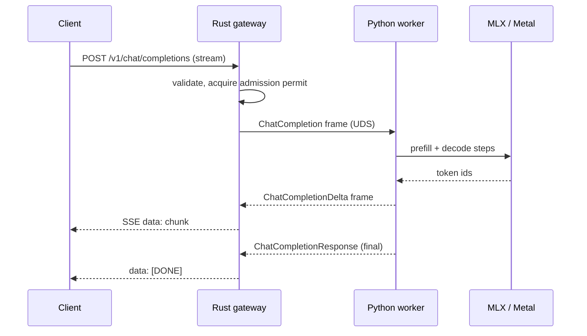

**Table of contents**

- [The path of one token](#the-path-of-one-token)
- [Why a hand-written server](#why-a-hand-written-server)
- [Nagle's algorithm and the first token](#nagles-algorithm-and-the-first-token)
- [The socket that inherited a flag](#the-socket-that-inherited-a-flag)
- [The IPC boundary](#the-ipc-boundary)
- [Backpressure: say no early](#backpressure-say-no-early)
- [Cancellation that reaches the GPU](#cancellation-that-reaches-the-gpu)
- [Supervision and failing fast](#supervision-and-failing-fast)
- [Metrics owned by the layer that produces them](#metrics-owned-by-the-layer-that-produces-them)
- [Takeaways](#takeaways)
- [Acknowledgments](#acknowledgments)

Inference optimization talk is mostly about the GPU. But for a single
streaming user on a Mac, the gateway sits on the path of every token. A
40 ms stall in TCP is four tokens' worth of decode. This post covers the
parts of MLX Air that are not about models at all.

## The path of one token



*Figure 1: A streaming request. Every token crosses the worker's
detokenizer, a Unix socket, and a TCP connection.*

## Why a hand-written server

The gateway is a `std::net` HTTP server with one thread per connection. No
async runtime, no framework. That is unusual, and deliberate:

- A local server has tens of connections, not tens of thousands. A thread
  per connection is simple, has no scheduler of its own to tune, and gives
  predictable latency.
- Every byte on the streaming path is under our control, which matters for
  the next two sections.
- One blocked client holds one thread. Admission limits bound how many
  threads that can be ([ADR-0003](../adr/0003-gateway-socket-and-sse-writes.md)).

## Nagle's algorithm and the first token

A streamed token is a tiny SSE frame:

```text
data: {"id":"...","choices":[{"delta":{"content":" the"}}],...}\n\n
```

TCP's **Nagle algorithm** holds small segments back until the previous
segment is acknowledged, to coalesce them. Combined with delayed ACKs on the
client side, that can hold a token for tens of milliseconds. For bulk
transfer that is a fine trade; for token streaming it adds latency to every
frame.

MLX Air does three things:

1. **`TCP_NODELAY` on every accepted connection.** Small frames go out at
   once. Non-streaming responses flush explicitly, so disabling Nagle is safe
   for all connections.
2. **Headers and the first event in one `write(2)`.** The HTTP response
   headers and the first `data:` event are coalesced, saving a syscall and
   avoiding a first token split across segments.
3. **Skip empty deltas.** A detokenizer can produce no text for a token (the
   first half of a multi-byte character, for example). Those deltas are not
   sent as empty SSE frames.

## The socket that inherited a flag

The HTTP listener is non-blocking, so the accept loop can poll for shutdown.
On macOS, an accepted socket **inherits** the listener's non-blocking flag
(Linux does not do this). A request whose body arrived a moment after its
headers then failed its read with `WouldBlock`, and the connection was
dropped without a response.

It surfaced only under benchmark load, as "server closed the connection
before the response" on the mixed and cache-pressure workloads, because only
then did bodies and headers arrive in separate packets. The fix sets every
accepted socket back to blocking mode, as the supervisor's control socket
already did. The lesson: anything that only fails under load needs a
load test that exercises it, and that is one reason the benchmark harness
stops at the first failed request instead of averaging over it
([post 11](2026-11-22-measuring-inference-honestly.md)).

## The IPC boundary

Gateway and worker talk over a **Unix domain socket** with **newline-delimited
JSON**:

- UDS avoids the TCP loopback stack and needs no port.
- JSON is debuggable with `nc -U` and a text editor. MessagePack would change
  only the encoder; the message shapes are fixed.
- Bootstrap is plain text (`STATUS\t{json}`, `READY`, `ERROR\t{json}`), so a
  worker that crashes during import still produces a readable error.

Socket paths are limited to 104 bytes on macOS, so host scripts put worker
sockets under `/tmp` rather than deep inside artifact directories
([ADR-0007](../adr/0007-worker-startup-failure-handling.md)). Audio uploads
for the Whisper endpoints arrive as base64 inside one multi-megabyte line, so
the worker reads up to 1 MiB per socket read.

Is JSON fast enough? A delta frame is a few hundred bytes; at 100 tokens per
second that is tens of kilobytes per second. The design keeps the option
open: if profiling ever shows serialization as a bottleneck, only the
encoder changes. `mlx-air profile` times worker transport as its own stage,
and the gateway exports `mlx_ipc_roundtrip_latency_ms`, so it would show.

## Backpressure: say no early

Admission happens in the gateway, before any work reaches the worker
(`[limits]` in the runtime config):

```toml
[limits]
max_active_requests = 16
max_pending_requests = 64
request_timeout_seconds = 300
```

- Under `max_active_requests`, a request proceeds.
- Otherwise it waits in a FIFO queue.
- If the queue is already at `max_pending_requests`, it gets **HTTP 429**
  immediately.
- If it waits longer than `request_timeout_seconds`, it gets **429
  `QUEUE_TIMEOUT`**.
- If the worker is down, **503**.

The queue is fully visible in Rust (`mlx_queue_depth`), and the worker never
builds its own unbounded queue. Inside the worker, the scheduler applies a
second, finer admission based on KV pages (post 3). An explicit 429 that a
client can retry is far better than a request that sits for minutes and times
out somewhere the operator cannot see.

## Cancellation that reaches the GPU

With a proxy, a disconnected client stops the proxy and nothing else. MLX
Air carries cancellation through:

1. A `DisconnectMonitor` thread `peek()`s the client socket; EOF or an error
   means the client is gone.
2. The gateway sends a `CancelRequest` frame to the worker.
3. The scheduler marks the request. At the next step boundary it is reaped,
   its KV pages are released, and it gets `finish_reason = "cancelled"`.
4. The gateway updates `mlx_requests_cancelled_total` and frees the admission
   slot.

Cancellation is **cooperative at step boundaries**. A forward pass in flight
finishes; only then is the request dropped. Interrupting a Metal command
buffer to save a few milliseconds would risk leaving the device in an
inconsistent state. In overlap mode, a request in the in-flight step is
protected until that step resolves, so its pages are never freed while the
GPU might still read them.

Freeing pages promptly matters more than freeing the GPU promptly. A
cancelled long request holds a large KV reservation; releasing it at the next
step lets a waiting request in.

## Supervision and failing fast

The gateway spawns the worker, waits for `READY`, and watches it with a
thread blocked in `child.wait()`. If the worker exits, readiness flips, the
model is marked failed, and requests get 503.

Startup failures are reported **at once**, not at the timeout
([ADR-0007](../adr/0007-worker-startup-failure-handling.md)). Some failures
can never succeed, such as a KV pool too small for the weights. `mlx-air
serve --detach`, launchd instances, and `mlx-air bench run` all poll
`/startup` while waiting and stop as soon as it reports `failed`, instead of
waiting out a readiness timeout as long as 30 minutes. Under launchd, a
changed gateway pid before readiness also counts as a failure, because
launchd restarts a crashed gateway and it will crash again. Each failure
names the setting to change, for example
`raise --memory-utilization above <value>` with the value that would fit.

## Metrics owned by the layer that produces them

The gateway exports Prometheus metrics, but it does not *compute* scheduler
or cache state from request totals. The worker sends typed metrics (step
latencies, batch sizes, KV pages, prefix hits) in its IPC events, and the
gateway projects them onto metric families such as
`mlx_scheduler_tick_latency_by_backend_ms` and
`mlx_kv_cache_pages_by_backend`. Request-level facts (TTFT, latency, queue
time, cancellations) are measured where they happen, in the gateway, and
logged as one structured JSON line per request:

```json
{"request_id":"req-1","prompt_tokens":19,"max_tokens":256,"stream":false,
 "queue_time_ms":0,"ttft_ms":null,"latency_ms":120,"completion_tokens":8,
 "finish_reason":"stop","cancelled":false,"error":null}
```

## Takeaways

- For streaming, disable Nagle and coalesce the first write.
- Test on the platform you ship on. macOS sockets inherit non-blocking mode.
- Reject early and explicitly. A 429 is a feature.
- Cancel at step boundaries, and make sure cancellation frees memory, not
  just compute.
- Fail at startup with a message that names the fix.

## Acknowledgments

The OpenAI-compatible API shape follows the
[OpenAI Chat Completions](https://platform.openai.com/docs/api-reference/chat)
and Server-Sent Events conventions that vLLM and SGLang also implement, which
is what lets existing clients talk to a Mac without changes.
