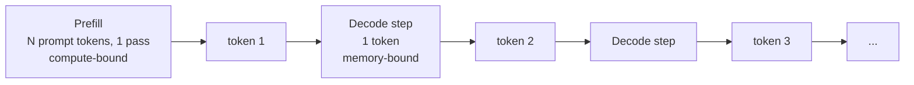

**Table of contents**

- [Two workloads in one request](#two-workloads-in-one-request)
- [The metrics that matter](#the-metrics-that-matter)
- [A back-of-the-envelope model of decode](#a-back-of-the-envelope-model-of-decode)
- [Arithmetic intensity and why batching is free (until it isn't)](#arithmetic-intensity-and-why-batching-is-free-until-it-isnt)
- [The KV cache is the real memory budget](#the-kv-cache-is-the-real-memory-budget)
- [What is different about Apple Silicon](#what-is-different-about-apple-silicon)
- [How this shapes the rest of the engine](#how-this-shapes-the-rest-of-the-engine)
- [Acknowledgments](#acknowledgments)

Every optimization in an inference engine is easier to understand once you
have a simple cost model in your head. This post builds that model from
first principles. Nothing here is specific to MLX Air, but the numbers come
from it, so you can check the model against a real system.

## Two workloads in one request

A chat completion has two phases.

**Prefill** runs the whole prompt through the model in one pass (or a few
chunks). For a 2,000-token prompt, every weight matrix multiplies a
`2000 x hidden` activation. That is a large matrix-matrix product, and it
keeps the GPU's arithmetic units busy. Prefill also writes the key and value
vectors of every prompt token into the **KV cache**, so later tokens never
recompute them.

**Decode** generates one token at a time. Each step feeds a single new token
through the model, attends to everything in the KV cache, samples the next
token, and appends one more K/V entry per layer. Each weight matrix now
multiplies a `1 x hidden` vector. The GPU must still read every weight from
memory, but it does very little math per byte read.



*Figure 1: One request is one compute-bound prefill followed by many
memory-bound decode steps.*

The same model, on the same GPU, behaves like two different programs. Most of
the design choices in a serving engine come from that one fact.

## The metrics that matter

Users feel two latencies, and operators care about one throughput:

| Metric | Definition | Dominated by | Better |
| --- | --- | --- | --- |
| **TTFT** (time to first token) | Request sent to first streamed token | Queueing + prefill | lower |
| **TPOT** (time per output token) | Mean gap between streamed tokens after the first | Decode step time | lower |
| **End-to-end latency** | Request sent to last token | TTFT + TPOT x tokens | lower |
| **Aggregate throughput** | Output tokens per second across all requests | Batch size x step rate | higher |

*Table 1: The metrics `mlx-air bench` reports. Each workload names one of
them as its primary metric.*

These pull against each other. Batching more requests raises throughput but
can lengthen each decode step. Running a long prefill gives the new request a
fast TTFT but stalls every running request's next token. A scheduler is a
policy for trading these off.

## A back-of-the-envelope model of decode

Take `mlx-community/Qwen3-4B-Instruct-2507-4bit`, MLX Air's primary benchmark
model. Its 4-bit weights, with quantization scales, take about 2.1 GB on disk. A
decode step for one request must stream all of them from memory once.

Assume a memory system that delivers about 270 GB/s, which is in the range of
current Pro-class Apple Silicon. Then the floor on one decode step is:

```text
2.1 GB / 270 GB/s ~= 7.8 ms per token
```

MLX Air measures **11.0 ms** TPOT on this model for a single stream
(`decode_128_c1`, run `decode-96bf4d2`). The gap between the floor and the
measurement is attention, the KV write, sampling, kernel launch overhead, and
the CPU work around each step. Those are exactly the things later posts in
this series attack.

Now take `mlx-community/LFM2.5-8B-A1B-MLX-4bit`. It has about 8B parameters
but is a mixture-of-experts model with roughly 1B active per token. Decode
reads only the experts it routes to, so its floor is far lower than its size
suggests. MLX Air measures **5.8 ms** TPOT on it, about half the dense 4B
model. For decode, what you pay for is *bytes touched per token*, not
parameter count.

## Arithmetic intensity and why batching is free (until it isn't)

**Arithmetic intensity** is floating-point operations per byte moved. A
matrix-vector product `W x` with a 4-bit `W` does about 2 operations per
weight (a multiply and an add) per row of `x`, and moves half a byte per
weight. With a batch of `B` decode rows, the same weight bytes feed `B`
vectors:

```text
intensity ~= 2 * B / 0.5 = 4B  FLOPs per byte
```

A GPU can perform many more operations per second than it can move bytes per
second, often by a factor of 50 to 100 or more. Until `4B` reaches that ratio,
adding a row to the batch costs almost nothing: the step is still waiting on
memory, and the extra math hides in the gaps. This is why **continuous
batching** is the single biggest throughput lever in LLM serving. Eight
concurrent decodes take not much longer than one.

It is not quite free, for two reasons:

1. **Attention does not share weights.** Each row attends to its own KV
   history. Attention bytes grow with `batch x context`, so long contexts eat
   the free lunch.
2. **Padding wastes work.** If rows of different lengths are packed into one
   rectangular tensor, the short rows pay for the long ones. MLX Air once ran
   every decode row as 256 positions because it shared a step with a 256-token
   prefill chunk; an eight-request step took about 3.6 s instead of 0.1 s.
   [Post 5](2026-11-22-continuous-batching-chunked-prefill.md) tells that
   story.

Prefill is the opposite case. With a 256-token chunk, intensity is already in
the hundreds, so prefill is compute-bound and batching more prefill rows
mostly makes the step longer.

## The KV cache is the real memory budget

Every token in flight keeps a key and a value vector for every layer. The size
per token is:

```text
bytes/token = 2 (K and V) x layers x kv_heads x head_dim x bytes/element
```

For Qwen3-4B (36 layers, 8 KV heads, head dimension 128, 16-bit cache):

```text
2 x 36 x 8 x 128 x 2 = 147,456 bytes ~= 144 KiB per token
```

A single 32k-token conversation therefore needs about 4.5 GiB of KV cache,
twice the size of the model's weights. For Qwen2.5-7B (28 layers, 4 KV
heads), the same formula gives 56 KiB per token: grouped-query attention with
fewer KV heads makes a larger model cheaper per token.

Three consequences follow:

- **Memory, not compute, decides how many requests you can run at once.**
  MLX Air sizes one KV pool at startup from `--memory-utilization`, the same
  way vLLM uses `--gpu-memory-utilization`, and admits a request only when its
  prompt plus `max_tokens` fits.
- **Fragmentation matters.** Allocating each request a contiguous
  max-length buffer wastes most of it. Paging fixes that
  ([post 3](2026-11-22-paged-kv-cache-unified-memory.md)).
- **Reuse is valuable.** Two requests with the same system prompt can share
  its KV pages instead of storing and computing them twice
  ([post 8](2026-11-22-prefix-caching-radix-vs-block-hash.md)).

## What is different about Apple Silicon

The model above applies to any accelerator. Three things make a Mac a
distinct target.

**Unified memory.** CPU and GPU share one physical memory. There is no PCIe
copy between host and device, and "GPU memory" is a share of system RAM that
Metal reports as the *recommended working set*. An engine that overcommits
does not get an out-of-memory error; the whole machine starts swapping. MLX
Air sizes the KV pool against the recommended working set, and bounds MLX's
cache of freed buffers (1 GiB by default) so shifting batch shapes cannot
creep into swap.

**Lazy evaluation.** MLX builds a graph of operations and runs it only when a
result is needed (`mx.eval`) or explicitly scheduled (`mx.async_eval`). That
makes it natural to build the next step's graph while the GPU runs the
current one, which is the subject of
[post 6](2026-11-22-overlap-scheduling-mlx-async-eval.md). It also means a
careless `.tolist()` or `.item()` in the hot path is a hidden synchronization
point.

**One GPU, one model, one user.** A local server rarely sees hundreds of
concurrent requests. Batch sizes of 1 to 16 are typical, so single-stream
latency matters as much as peak throughput, and CPU overhead per step, which
a large datacenter batch would amortize, shows up directly in TPOT.

## How this shapes the rest of the engine

| Fact from the cost model | Engine feature | Post |
| --- | --- | --- |
| KV cache dominates memory and fragments | Paged KV pool with block tables | 3 |
| Decode attention reads the whole cache | Paged decode kernel in Metal | 4 |
| Batching decode is nearly free; padding is not | Continuous batching, phase-homogeneous steps | 5 |
| Small batches expose CPU overhead | Overlap of CPU step building with GPU execution | 6 |
| Device-to-host reads are sync points | On-device sampling | 7 |
| Shared prompts repeat prefill | Radix prefix cache | 8 |

*Table 2: The cost model, mapped to the rest of the series.*

## Acknowledgments

The roofline framing of decode as memory-bound is standard; we found the
[vLLM PagedAttention paper](https://arxiv.org/abs/2309.06180) and the
[MLX documentation on lazy evaluation](https://ml-explore.github.io/mlx/build/html/usage/lazy_evaluation.html)
the clearest references for the two halves of this post.
