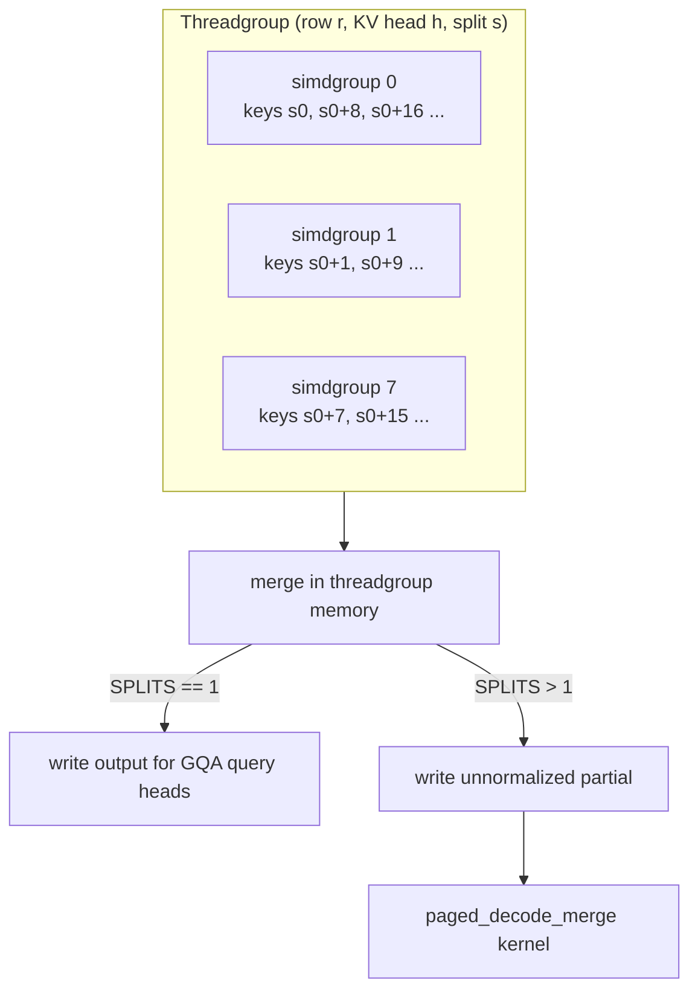

**Table of contents**

- [Why a custom kernel](#why-a-custom-kernel)
- [The shape of decode attention](#the-shape-of-decode-attention)
- [A Metal primer in one table](#a-metal-primer-in-one-table)
- [Launch geometry](#launch-geometry)
- [Online softmax](#online-softmax)
- [The inner loop](#the-inner-loop)
- [Merging simdgroups and splits](#merging-simdgroups-and-splits)
- [Choosing the split count](#choosing-the-split-count)
- [Dtypes, templates, and warmup](#dtypes-templates-and-warmup)
- [Results](#results)
- [What the kernel does not do](#what-the-kernel-does-not-do)
- [Acknowledgments](#acknowledgments)

This is the most Apple-specific post in the series. It walks through
`python/mlx_worker/native_mlx/kernels/paged_decode.metal`, the kernel that
computes decode attention for MLX Air's native backend. If you have read
about FlashAttention or FlashDecoding on CUDA, most ideas will be familiar;
the vocabulary and the constraints are Metal's.

## Why a custom kernel

MLX ships a fast fused attention, `mx.fast.scaled_dot_product_attention`
(SDPA). It expects dense K and V tensors of shape
`(batch, kv_heads, seq, head_dim)`. Our KV cache is paged
([post 3](2026-11-22-paged-kv-cache-unified-memory.md)). To use SDPA, every
layer of every step must first **gather** each row's pages into a dense,
padded tensor:

```python
row_keys = key_cache[page_ids].reshape(-1, kv_heads, head_dim)[:total_length]
row_keys = mx.pad(row_keys.transpose(1, 0, 2), [(0, 0), (0, pad), (0, 0)])
dense_keys = mx.stack(key_rows)
```

For decode, that gather copies the entire cache to compute attention for one
token per row. The copy costs more than the attention once contexts grow, and
it grows with batch size. The fix is the one PagedAttention made famous:
follow the block table *inside* the attention loop and read K/V where they
already live.

MLX Air still uses gather + SDPA for prefill, where many query tokens amortize
the copy, and for head dimensions that are not a multiple of 32.

## The shape of decode attention

For one row and one query head, decode attention is:

```text
s_t = (q . k_t) * scale          for t in [0, L)
p_t = exp(s_t - max_s) / sum_j exp(s_j - max_s)
o   = sum_t p_t * v_t
```

One query vector, `L` key and value vectors. Each key is read once and used
for one dot product. That is about 2 FLOPs per element loaded, so the kernel
is purely memory-bound. The job is to read K and V once, at full bandwidth,
with enough parallelism to keep every GPU core busy.

With **grouped-query attention (GQA)**, several query heads share one KV head.
Qwen3-4B has 32 query heads and 8 KV heads: a group of 4. A kernel that
processes one query head at a time reads each key 4 times. Ours processes the
whole group together and reads each key once.

## A Metal primer in one table

| Metal term | CUDA analog | In this kernel |
| --- | --- | --- |
| thread | thread | One lane; owns `HEAD_DIM / 32` elements of a head |
| simdgroup (32 threads) | warp | Scans a strided subset of keys |
| threadgroup | thread block | One (row, KV head, split) |
| threadgroup memory | shared memory | Partial softmax results for the merge |
| `simd_sum` | warp shuffle reduction | The dot product across 32 lanes |
| `mx.fast.metal_kernel` | (custom op) | Compiles our source into an MLX op |

*Table 1: Just enough Metal vocabulary to read the kernel.*

MLX's `mx.fast.metal_kernel` takes a kernel body as a string, generates the
argument list, and compiles one variant per set of template arguments. We
keep the real bodies in `.metal` files; the Python string only declares
threadgroup scratch and forwards arguments
([ADR-0006](../adr/0006-paged-decode-attention-kernel.md)).

## Launch geometry

```text
grid.x       = rows * KV_HEADS            one threadgroup per (row, KV head)
grid.y       = SPLITS                     key ranges per row
threadgroup  = SIMDGROUPS * 32 threads    up to 8 simdgroups
```



*Figure 1: Work decomposition. Simdgroups stride over the keys of one split;
their partial softmaxes merge in threadgroup memory, and splits merge in a
second kernel.*

Each of the 32 lanes in a simdgroup owns `HEAD_DIM / 32` consecutive
elements of the head (4 elements for `head_dim = 128`). A key is loaded
cooperatively by all 32 lanes, each loading its 4 elements, so one key costs
one coalesced 256-byte read for 16-bit K.

The number of simdgroups is the largest power of two up to 8 whose merge
buffers fit in 32 KiB of threadgroup memory:

```text
merge_bytes = 4 * SIMDGROUPS * GQA * (HEAD_DIM + 2)
```

For Qwen3-4B (`GQA = 4`, `HEAD_DIM = 128`), 8 simdgroups need 16,640 bytes,
so each threadgroup runs 256 threads.

## Online softmax

Softmax needs the maximum score before it can normalize, but we do not want
two passes over the keys. **Online softmax** keeps a running maximum `m` and a
running sum `l` and rescales them whenever the maximum grows. From
`kernels/online_softmax.metal`:

```cpp
inline float2 online_softmax_push(thread OnlineSoftmax& state, float score) {
  float new_max = max(state.max_score, score);
  float factor = fast::exp(state.max_score - new_max);
  float weight = fast::exp(score - new_max);
  state.max_score = new_max;
  state.sum_exp = state.sum_exp * factor + weight;
  return float2(factor, weight);
}
```

The caller applies the same `factor` to its output accumulator and adds
`weight * v`. After the last key, `o / l` is the exact softmax-weighted sum.

Partial results over disjoint key ranges merge the same way: rescale each to
the global maximum and add. A partial that saw no keys has maximum `-inf`
and must contribute nothing, which `online_softmax_rescale` handles
explicitly instead of computing `exp(-inf - -inf)`.

## The inner loop

Here is the heart of `paged_decode_attention`, lightly trimmed:

```cpp
int length = lengths[row];
int start = window > 0 ? max(0, length - window) : 0;
int span = (length - start + SPLITS - 1) / SPLITS;
int split_start = start + int(split) * span;
int split_end = min(length, split_start + span);
auto table = block_tables + row * table_width;
for (int t = split_start + int(simd); t < split_end; t += SIMDGROUPS) {
  uint page = uint(table[t / PAGE_SIZE]);
  uint base = ((page * PAGE_SIZE + uint(t % PAGE_SIZE)) * KV_HEADS + kv_head) *
          HEAD_DIM + lane * EPL;
  float k[EPL];
  float v[EPL];
  for (int i = 0; i < EPL; i++) {
    k[i] = static_cast<float>(key_pages[base + i]);
    v[i] = static_cast<float>(value_pages[base + i]);
  }
  for (int g = 0; g < GQA; g++) {
    float score = 0.0f;
    for (int i = 0; i < EPL; i++) {
      score += qv[g][i] * k[i];
    }
    float2 scales = online_softmax_push(state[g], simd_sum(score));
    for (int i = 0; i < EPL; i++) {
      o[g][i] = o[g][i] * scales.x + scales.y * v[i];
    }
  }
}
```

Points worth noticing:

- **The block table lookup is the only paging cost.** `table[t / PAGE_SIZE]`
  is one integer read per key, and for 16-token pages it hits the same entry
  16 times in a row.
- **K and V are read once and reused across the GQA group.** The `g` loop
  runs over query heads in registers; `qv` was pre-scaled by the softmax
  scale when it was loaded.
- **`simd_sum` replaces shared memory for the dot product.** Each lane has a
  partial dot product over its 4 elements; one hardware reduction gives every
  lane the full score.
- **Rows of different lengths need no padding.** Each threadgroup reads its
  own `lengths[row]` and stops there. A step can mix a 40-token and a
  4,000-token row with no wasted work on the short one.
- **Sliding windows are free.** `start = length - window` skips old keys
  without a mask (Gemma 3 uses this).

## Merging simdgroups and splits

After the loop, each simdgroup holds a partial `(m, l, o)` per query head.
Lane 0 writes `m` and `l`, all lanes write their `o` elements into threadgroup
memory, and after a barrier every thread merges one output element across the
simdgroups:

```cpp
float group_max = max over s of maxes[g][s];
total = sum over s of sums[g][s]  * exp(maxes[g][s] - group_max);
acc   = sum over s of outputs[s][g][e] * exp(maxes[g][s] - group_max);
```

With one split, the thread writes `acc / total` to the output in the query's
dtype. With several splits, it writes the *unnormalized* `acc`, `group_max`,
and `total` to float32 scratch buffers, and a second tiny kernel,
`paged_decode_merge`, launched with one threadgroup per head and one thread
per head element, does the same rescale-and-add across splits.

## Choosing the split count

Layers run one after another, and each layer's attention is one kernel
launch. With one threadgroup per (row, KV head), a single-row step on an
8-KV-head model launches **8 threadgroups**. A Pro-class Apple GPU has well
over 8 cores, so most of the GPU idles during attention.

The fix is FlashDecoding's split-K: give each row's keys to several
threadgroups and merge afterward. `splits_for` in `paged_decode.py` picks a
power of two:

```python
limit = min(
    32,                              # at most 32 splits
    max(1, 32 // (rows * kv_heads)), # aim for ~32 threadgroups per step
    max(1, max_keys // 32),          # at least 32 keys per split
)
```

Steps with many rows already launch enough threadgroups and keep one split.
Short batches at long contexts get more.

The minimum keys per split was originally 256. Profiling a GPU-bound
Qwen3-4B decode (128 chained steps, one synchronization) showed the paged
kernel taking **0.48 ms** per step at a 64-token context, against **0.20 ms**
for MLX SDPA on dense K/V. At 64 keys and a 256-key minimum, the kernel ran
8 threadgroups. Lowering the minimum to 32 keys gives 2 splits at 64 keys
and 4 splits from 128 keys, and the merge launch costs less than the
parallelism gains.

## Dtypes, templates, and warmup

The kernel is templated on everything that changes its code:

```text
Q, KV, QUERY_HEADS, KV_HEADS, HEAD_DIM, PAGE_SIZE, SIMDGROUPS, SPLITS,
Table, Lengths
```

Two of these deserve a note:

- **`Q` and `KV` are separate.** A quantized checkpoint can produce float16
  activations over a bfloat16 cache, or the reverse, and a Hadamard-rotated
  pack keeps its cache in float32 (post 9). When the kernel body first moved
  into a `.metal` file, all three inputs were typed as `Q`, and
  `Qwen2.5-7B-Instruct-4bit` (float16 activations over a bfloat16 cache)
  failed to compile the kernel at its first decode step. A parity test now
  covers all four float16/bfloat16 pairings against a float32 reference.
- **`Table` and `Lengths` are pointer types.** MLX passes single-element
  inputs in Metal's `constant` address space and larger ones in `device`
  memory, so a one-row step and a two-row step need different signatures.

Every combination is a separately compiled kernel, and MLX compiles on first
use. Without care, the first real request at a new context length would pay
a compile stall. Before reporting ready, the worker decodes 4 tokens from a
prompt sized to land in the middle of each split count's range
(`warmup_key_counts`): 48, 96, and 192 keys for an 8-KV-head model. A
slightly longer or shorter real prompt then reuses an already compiled
variant. On an M4 Pro, the whole warmup takes 0.6 s for Qwen3-4B.

## Results

The paged decode kernel and the commit-path fix that landed with it
(`500de9e`), measured by `mlx-air bench run --suite optimization --focus decode`,
serial mode so the scheduler overlap of post 6 is not mixed in:

| Model | `decode_128_c1` TPOT, serial, before (f70afde) | after (1793318) |
| --- | ---: | ---: |
| Qwen3-4B-Instruct-2507 4-bit | 14.62 ms | 13.13 ms |
| LFM2.5-8B-A1B 4-bit | 18.89 ms | 7.63 ms |

*Table 2: Mean time per output token, lower is better. Run IDs
`decode-f70afde` and `decode-1793318`. The candidate run also contains the
decode-chaining change, which affects only overlap mode.*

The split-count change, measured in isolation as GPU-bound step time on
Qwen3-4B (lower is better):

| Keys | Before | After | `mlx_lm` |
| ---: | ---: | ---: | ---: |
| 64 | 11.34 ms | 11.06 ms | 10.80 ms |
| 256 | 11.77 ms | 11.14 ms | 10.98 ms |
| 1,024 | 11.95 ms | 11.75 ms | 11.83 ms |

*Table 3: Whole-step time, so attention is only part of each number. This
change also included the slice-copy KV write from post 3. At 1,024 keys the
paged path is now faster than `mlx_lm`'s dense cache.*

## What the kernel does not do

- **Prefill.** Many query tokens per row change the trade-off; prefill uses
  gather + SDPA.
- **Head dimensions that are not a multiple of 32.** These fall back to the
  gather path.
- **Quantized KV.** The cache is 16- or 32-bit floating point.
- **Attention sinks or other new attention semantics.** Those need an
  explicit model-interface extension.

## Acknowledgments

The kernel's structure follows
[FlashAttention](https://arxiv.org/abs/2205.14135) (online softmax),
[PagedAttention](https://arxiv.org/abs/2309.06180) (block-table indexing),
and [Flash-Decoding](https://crfm.stanford.edu/2023/10/12/flashdecoding.html)
(split-K for long contexts at small batch). MLX's `mx.fast.metal_kernel` made
it possible to ship a custom kernel without a C++ extension.
