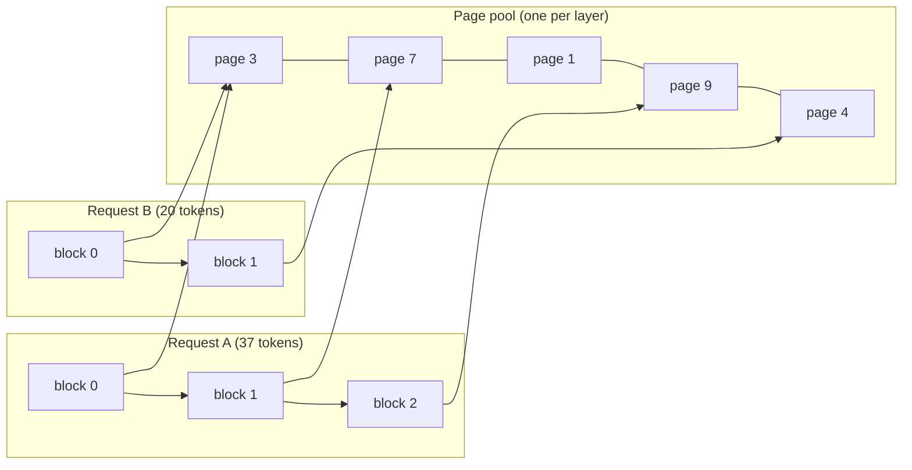

**Table of contents**

- [The problem paging solves](#the-problem-paging-solves)
- [Pages, pools, and block tables](#pages-pools-and-block-tables)
- [Sizing the pool on a Mac](#sizing-the-pool-on-a-mac)
- [Admission: promise pages before you need them](#admission-promise-pages-before-you-need-them)
- [Sharing pages: forks, reference counts, and copy-on-write](#sharing-pages-forks-reference-counts-and-copy-on-write)
- [Writing into the pool without copying it](#writing-into-the-pool-without-copying-it)
- [Transactional reservations](#transactional-reservations)
- [Observability](#observability)
- [Takeaways](#takeaways)
- [Acknowledgments](#acknowledgments)

[Post 2](2026-11-22-inference-101-prefill-decode.md) showed that the KV cache,
not the weights, decides how many requests fit in memory. This post covers how
MLX Air stores it. The core idea is vLLM's PagedAttention; the interesting
parts are what changes with unified memory and a lazily evaluated framework.

## The problem paging solves

The simplest KV cache gives each request a contiguous buffer sized for its
maximum length. It works for one request and falls apart for many:

- **Internal fragmentation.** A request that may run to 8k tokens but stops
  at 300 leaves 96% of its buffer unused for its whole life.
- **External fragmentation.** Buffers of different sizes come and go, and
  the free memory ends up in holes too small for the next request.
- **No sharing.** Two requests with the same 1,000-token system prompt store
  identical K/V twice.

Paging treats the KV cache the way an operating system treats RAM: split it
into fixed-size pages, give each request a table of page IDs, and allocate
pages only as tokens arrive.

## Pages, pools, and block tables

MLX Air allocates, at startup, one key pool and one value pool per attention
layer. Each is a single MLX array:

```text
key_pages[layer]   : (num_pages, page_size, kv_heads, head_dim)
value_pages[layer] : (num_pages, page_size, kv_heads, head_dim)
```

The page size is 16 tokens by default (8 and 32 are also allowed, via
`MLX_RUNTIME_NATIVE_KV_PAGE_SIZE`). Every request owns a **block table**, a
list of page IDs. Token `t` of a request lives at:

```text
page = block_table[t // page_size]
slot = t %  page_size
```



*Figure 1: Block tables map logical blocks to physical pages. Here A and B
share page 3 (a common 16-token prefix). A wastes 11 slots in its last page,
B wastes 12; no request wastes more than one page.*

Internal fragmentation is now bounded by one page per request, and external
fragmentation disappears because every page is the same size.

For hybrid models (post 9), only the attention layers get pages. LFM2.5-8B-A1B
has 24 layers but only 6 use attention, so its pool is a quarter of the size a
naive per-layer pool would need for the same token capacity.

## Sizing the pool on a Mac

On a discrete GPU, "how much memory can I use?" has a clear answer. On Apple
Silicon, the GPU shares system RAM, and Metal reports a *recommended working
set*: the amount it expects the GPU can use without hurting the rest of the
system. Exceed it and the Mac does not fail fast; it swaps, and every token
gets slower.

MLX Air sizes the pool the way vLLM does with `--gpu-memory-utilization`, but
against the recommended working set (`python/mlx_worker/native_mlx/memory.py`,
`plan_kv_pool`):

```text
budget  = utilization x recommended_working_set
reserve = mlx_buffer_cache_limit
        + prefill_tokens x 2 bytes x (4 x hidden + 3 x intermediate)
        + prefill_rows x vocab x 4 bytes
        + 256 MiB slack
pool    = budget - weights - reserve
```

The reserve estimates the activations of the largest prefill step (hidden
states and MLP intermediates), the float32 logits of every row, and MLX's
cache of freed buffers, which is bounded to 1 GiB by default. Without that
bound, a run of changing batch shapes leaves freed buffers of every size
behind and the process grows into swap.

The default `--memory-utilization` is 0.5. If the weights and reserve do not
fit, startup fails with the number to set:

```text
memory utilization <u> gives <budget>GiB of the <working set>GiB working set,
but the weights need <w>GiB and the activation reserve <r>GiB; raise
--memory-utilization above <needed> or set --kv-cache-memory
```

Operators who want a fixed size can pin it with `--kv-cache-memory 4GiB`.

The pool size then bounds the per-request token limit. If the operator did
not set `max_total_tokens_per_request`, it is lowered to what the pool can
hold. If they did set it and it does not fit, startup refuses
(`resolve_max_total_tokens`). Failing at startup is better than failing the
first long request at 2 a.m.

## Admission: promise pages before you need them

A paged pool can still run out. The question is *when* you find out. vLLM
can preempt a running request and recompute or swap its KV later. MLX Air
chooses a simpler invariant: **a running request never fails for lack of
KV pages.**

To keep it, the scheduler reserves pages for a request's whole life at
admission time (`scheduler.py`, `_admission_pages`):

```text
needed = ceil((prompt + max_tokens) / page_size) - reused_prefix_pages + 1
```

The `+1` covers a copy-on-write split of a shared last page (below). The free
count it compares against is not just "free pages"; it subtracts every page
already *promised* to running requests that have not grown into them yet
(`_kv_available_pages`).

When the oldest waiting request does not fit:

1. The scheduler evicts least-recently-used prefix-cache entries that no
   running request pins, and re-probes the prefix cache, because eviction may
   have removed the very prefix this request matched.
2. If it still does not fit and other requests are running, it waits.
   Later arrivals wait behind it, so a stream of short requests cannot starve
   a long one.
3. Decode keeps running meanwhile, so running requests finish and return
   their pages.

The trade-off is recorded in
[ADR-0004](../adr/0004-native-scheduler-and-sampling.md): head-of-line
blocking can leave pages idle while a large request waits. A request with a
huge `max_tokens` that stops early also holds more reservation than it uses.
In exchange there is no preemption path, no recompute, and no request that
gets halfway and dies.

## Sharing pages: forks, reference counts, and copy-on-write

Each page carries a reference count. `fork(handle, new_request, length)`
creates a new block table that points at the first
`ceil(length / page_size)` pages of an existing one and increments their
counts. Nothing is copied. This is how the prefix cache hands a cached system
prompt to a new request.

The subtle case is the last shared page. Suppose a 40-token prefix is cached:
pages 0 and 1 are full, page 2 holds 8 tokens. A new request forks it and
appends token 41. Writing into page 2 in place would corrupt every other
request sharing it. So the reservation for that step allocates a fresh page,
copies the 8 tokens across, and redirects the new request's block table. That
copy is the extra page in the admission formula.

A separate **pin** count marks pages that an in-flight step is reading or
writing. A page returns to the free list only when both its reference count
and pin count reach zero. An early version found free pages by rescanning
every page with list-membership tests, about 1.2 ms of CPU per step with 910
pages. Now only pages whose counts changed in this step are checked, which
also frees a page the moment its last pin drops.

## Writing into the pool without copying it

This is where MLX's semantics matter. MLX arrays are immutable values. The
statement

```python
flat_keys[slots] = new_keys
```

does not mutate `flat_keys`; it produces a new array. MLX can implement it
in place, without copying the source buffer, only when nothing else holds a
reference to the old buffer. This is called **buffer donation**. If any
Python object still points at the old pool array (a debug variable, a metrics
snapshot, a closure, a finished reservation), MLX copies the whole layer pool
to produce the new one. For a 4 GiB pool, that is a disaster you cannot see
in the code.

[ADR-0005](../adr/0005-paged-kv-cache-writes-and-buffer-lifetime.md) records
the rules that keep writes in place:

- **Replace, don't retain.** `stage_layer` stores the updated array back into
  `backend.key_pages[layer]` right away, so the pool's own reference moves to
  the new buffer.
- **Drop staged arrays when done.** A finished reservation clears its
  references, so it cannot keep an old buffer alive into the next step.
- **Pack without per-row slices when possible.** When every row appends the
  same number of tokens, as in every decode step, the new K/V are already in
  row-major `(row, position)` order and one reshape packs them.
- **Prefer a slice copy to a scatter.** When a step's slots are consecutive
  (for example a single decode row, even across a page boundary), `flat[start:end] = rows` is cheaper on the GPU than an
  indexed scatter.

The slice-copy rule was part of the change that closed the short-context
decode gap to `mlx_lm`. Together with the kernel split change in
[post 4](2026-11-22-paged-decode-attention-metal.md), GPU-bound Qwen3-4B step
time at 64 keys went from 11.34 ms to 11.06 ms, against 10.80 ms for
`mlx_lm`.

## Transactional reservations

A model step is a transaction against the cache:

```text
reserve_batch(caches, token_lengths) -> reservation
  per layer: reservation.stage_layer(layer, k, v)
reservation.commit()   # or abort()
```

`reserve_batch` assigns slots (allocating pages, splitting shared last pages)
but changes no block table. `commit` publishes the new lengths. `abort`
releases everything the reservation allocated. A step that fails in the
middle of the model leaves the cache exactly as it was, and only the affected
requests get an error.

The overlap executor ([post 6](2026-11-22-overlap-scheduling-mlx-async-eval.md))
adds one twist: `commit(synchronize=False)` publishes step N's append before
the GPU has finished computing it. Step N+1 can then reserve on top of it and
read N's K/V through the MLX dependency graph, so the GPU sees a correct
ordering even though the CPU never waited.

## Observability

The pool exports its state as Prometheus gauges:

| Metric | Meaning |
| --- | --- |
| `mlx_kv_cache_pages_by_backend` | Total, used, free, and pinned pages |
| `mlx_kv_cache_active_bytes_by_backend` | Bytes in used pages |
| `mlx_kv_cache_fragmentation_tokens_by_backend` | Unused slots in partially filled last pages |

*Table 1: KV cache metrics. With 16-token pages, fragmentation is at most 15
tokens per request.*

## Takeaways

- Paging bounds waste at one page per request and makes sharing a pointer
  copy.
- On unified memory, size against Metal's recommended working set and bound
  MLX's buffer cache, or the failure mode is swap, not an error.
- Reserving a request's whole lifetime at admission removes preemption at the
  cost of some idle pages.
- In a functional array framework, *who holds a reference* decides whether a
  write is O(new tokens) or O(pool size).

## Acknowledgments

The paging design follows
[Efficient Memory Management for Large Language Model Serving with PagedAttention](https://arxiv.org/abs/2309.06180)
(Kwon et al., SOSP 2023). The memory-utilization knob mirrors vLLM's
`--gpu-memory-utilization`.
