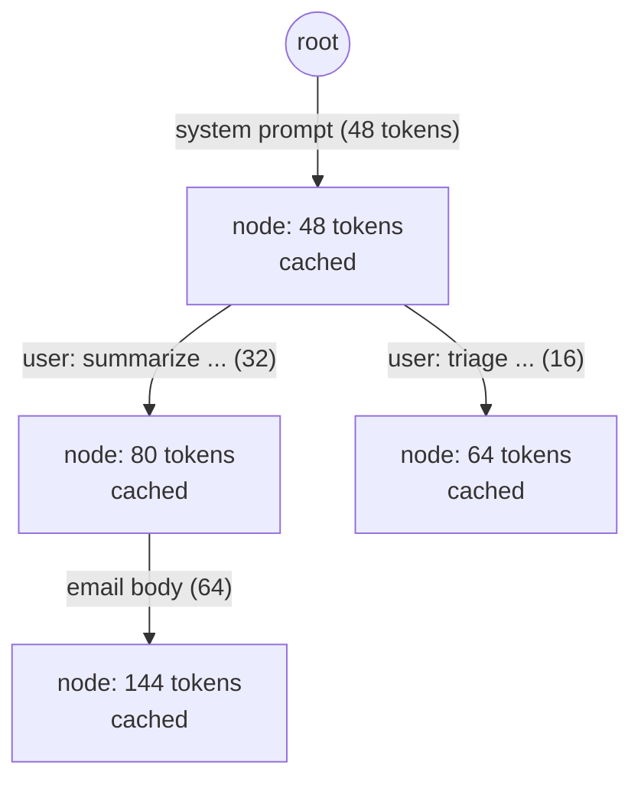

**Table of contents**

- [Why prefixes repeat](#why-prefixes-repeat)
- [The contract: probe, acquire, publish, release](#the-contract-probe-acquire-publish-release)
- [Strategy 1: block-hash chains](#strategy-1-block-hash-chains)
- [Strategy 2: a compressed radix tree](#strategy-2-a-compressed-radix-tree)
- [Never reuse the last token](#never-reuse-the-last-token)
- [Is this KV actually compatible?](#is-this-kv-actually-compatible)
- [Eviction and memory pressure](#eviction-and-memory-pressure)
- [Equal hits, unequal latency](#equal-hits-unequal-latency)
- [Results](#results)
- [When there is no prefix cache](#when-there-is-no-prefix-cache)
- [Acknowledgments](#acknowledgments)

## Why prefixes repeat

Real traffic repeats itself at the start. A chat application sends the same
system prompt with every request. A multi-turn conversation resends every
previous turn. A mail assistant runs three task prompts over thousands of
emails. An agent loop resends its tool definitions on every call.

Without reuse, each of these prefills the shared part again, paying full
prefill compute and storing a second copy of identical K/V. **Automatic prefix
caching (APC)** keeps the KV pages of recent prompts and lets a new request
start from the longest cached prefix of its own prompt. With a paged cache
([post 3](2026-11-22-paged-kv-cache-unified-memory.md)), "start from" is
cheap: fork the cached block table, bump reference counts, and prefill only
the suffix.

## The contract: probe, acquire, publish, release

Both strategies implement the same four operations
(`python/mlx_worker/native_mlx/prefix_cache.py`):

| Operation | When | What it does |
| --- | --- | --- |
| `probe(tokens)` | Scheduling | Longest cached prefix, without side effects |
| `acquire(id, tokens, probe)` | Admission | Pin the entry, fork its pages for the request |
| `publish(handle, tokens, committed)` | After prefill progress | Add newly completed full pages to the index |
| `release(handle)` | Request ends | Unpin; entries stay cached until evicted |

*Table 1: The prefix-cache adapter interface. `NoPrefixCache` implements the
same interface and reuses nothing.*

Only **full pages** of **prompt** tokens are published. A partially filled
last page would be written by its owner as it decodes, and generated tokens
are rarely a prefix of anyone else's prompt. Decode K/V is never published,
which is also what makes the overlap scheduler's discarded post-EOS token
safe (post 6).

The strategy is chosen at startup with
`MLX_RUNTIME_NATIVE_PREFIX_CACHE_STRATEGY=radix|block-hash`. Radix is the
default.

## Strategy 1: block-hash chains

vLLM's approach gives every full page a hash that covers the page's tokens
*and* the hash of the page before it:

```python
def _block_hash(parent_hash, page_tokens):
    payload = json.dumps(
        {"compatibility": fingerprint, "parent": parent_hash, "tokens": page_tokens},
        sort_keys=True, separators=(",", ":"),
    )
    return hashlib.sha256(payload.encode()).hexdigest()
```

Chaining makes the hash of page `k` identify the *entire* prefix up to page
`k`, so a flat dictionary `hash -> entry` is enough. To probe, hash the
prompt page by page and stop at the first miss.

It is simple and robust. The cost is CPU time: MLX Air's implementation
builds the whole hash chain for the reusable part of the prompt before it
looks anything up, so every probe serializes and SHA-256-hashes every full
page of the prompt, even when the first page misses. MLX Air also rejects any entry whose
stored token prefix does not match the request, so a hash collision cannot
silently reuse the wrong K/V (`prefix_collisions_rejected`).

## Strategy 2: a compressed radix tree

SGLang's RadixAttention stores prefixes in a **radix tree** keyed by exact
token IDs. Each edge holds a run of tokens; a node marks a prefix length that
has cached KV.



*Figure 1: A radix tree after three requests that share a 48-token system
prompt. Edges are compressed token runs; with 16-token pages every cached
node sits on a page boundary.*

Probing walks from the root, choosing the child by the next token and
comparing the edge's tokens against the prompt. It touches each prompt token
at most once and does no hashing. Inserting a prefix that diverges in the
middle of an edge **splits** the edge into a shared part and two children.

In MLX Air every cached node holds exactly one page of its own (the page that
completes its prefix), forked from the request that published it. So a
node's bytes are one page, and the cache's total size is
`entries x page_bytes` ([ADR-0005](../adr/0005-paged-kv-cache-writes-and-buffer-lifetime.md)).

## Never reuse the last token

The lookup caps how much it will reuse:

```python
max_reusable = ((len(token_ids) - 1) // page_size) * page_size
```

Even when the whole prompt is cached, at least one token must be prefilled.
The model's logits for the first generated token come from running the last
prompt token through the network; if every prompt token came from the cache,
there would be nothing to run and no logits to sample from.

This is not hypothetical. The `v1` backend once had exactly this bug: an exact
prompt match passed an empty suffix into `mlx-lm`'s `BatchGenerator`, which
made cache-hit benchmarks against it meaningless until it was fixed to fall
back to the full prompt.

## Is this KV actually compatible?

KV pages are only reusable by the model that produced them, with the same
tokenizer, dtypes, quantization, and page layout. Each cache carries a
`PrefixCompatibilityFingerprint`:

```text
checkpoint, architecture_class, tokenizer_assets_hash,
model_dtype, kv_dtype, quantization, page_size, cache_schema_version
```

Its SHA-256 digest is mixed into every block hash and every radix node
digest. Today the cache lives only as long as one worker process, so this is
defense in depth; it becomes essential the moment KV is persisted or shared.

## Eviction and memory pressure

The prefix cache does not get its own memory. It shares the KV pool with
running requests. An entry that a running request has acquired is **pinned**
and cannot be evicted. Unpinned entries are evicted least recently used
first:

- when the cache exceeds `MLX_RUNTIME_TEXT_CACHE_MAX_ENTRIES` (if set);
- when admitting a new request needs pages the pool does not have free. The
  scheduler calls `reclaim(pages)`, then probes again, because the entry the
  request matched may be the one that was just evicted.

Radix evicts **leaves** and prunes ancestors that become empty, so a shared
system-prompt node outlives the per-request branches below it.

## Equal hits, unequal latency

After radix became the default, one mixed workload was *slower* with radix
than with block-hash, even though both reused exactly the same number of
tokens (1,808) and pages (113):

| Workload | radix | block-hash |
| --- | ---: | ---: |
| few short + many long prompts, concurrent | 520.1 ms | 509.8 ms |

*Table 2: Mean latency, lower is better, initial measurement.*

When two caches hit equally, the difference is host overhead. A model-graph
profile showed model layers accounting for only 6 to 8% of this workload's
wall time, so the work was on the CPU side. Three fixes followed.

**Publish only new pages.** With chunked prefill, the scheduler publishes
after every chunk. Each publish walked every page-aligned prefix length from
page 1 to the current length and re-inserted all of them, so a 2,000-token
prompt in 256-token chunks re-checked its first pages eight times. Radix now
remembers the published length per handle and starts from the next page;
if the committed length has not reached a new page boundary, `publish`
returns immediately.

**Compare edges without slicing.** Lookup compared each edge against
`token_ids[offset:offset + n]`, allocating a new tuple per edge. It now
compares in place by offset and limit (`_common_prefix_len_at`).

**Cache the metrics.** Metrics were computed by walking the whole tree on
every metrics emission, which happens every step. They are now cached and
invalidated only on probe, acquire, publish, release, and eviction.

We also added scheduler stage timers (`scheduler_cache_probe_ms`,
`scheduler_cache_acquire_ms`, `scheduler_cache_publish_ms`, ...). After the
fixes they round to 0 ms, which tells us the remaining host cost is below
millisecond resolution.

## Results

Same-run comparison after the fixes, same checkpoint, prompts, and gateway
(mean latency, lower is better):

| Workload | radix | block-hash | `v1` |
| --- | ---: | ---: | ---: |
| shared prefix, exact hit | 139.1 ms | 139.3 ms | 516.2 ms |
| shared prefix, partial hit | 138.6 ms | 139.1 ms | 413.3 ms |
| shared prefix, mixed hit ratio | 217.7 ms | 227.8 ms | 495.7 ms |
| few long + many short prompts | 1,006.0 ms | 1,015.9 ms | 1,426.2 ms |
| few short + many long prompts | 507.2 ms | 529.4 ms | 1,485.8 ms |

*Table 3: Radix went from 10.3 ms slower than block-hash to 22.2 ms faster on
the regressed row, and is neutral or faster on every row. Absolute numbers
moved between runs, so the same-run radix vs. block-hash column is the
stronger signal.*

The exact-hit row also shows what prefix caching is worth: 139 ms versus
516 ms for a backend that recomputes the prefix.

## When there is no prefix cache

Hybrid models such as LFM2 and Qwen3.5 run with `NoPrefixCache`. Their
recurrent layers keep a running state that summarizes the whole history; it
cannot be truncated to "the state after token 512" the way a list of KV pages
can. [Post 9](2026-11-22-serving-hybrid-models.md) explains why. The
benchmark harness accounts for this: `primed` workloads record whatever a
backend reuses, so a backend without prefix reuse can still be compared on
the same traffic.

## Acknowledgments

Hash-chained block caching follows vLLM's
[automatic prefix caching](https://docs.vllm.ai/en/latest/design/prefix_caching.html).
The radix tree follows SGLang's RadixAttention from
[Zheng et al., SGLang: Efficient Execution of Structured Language Model Programs](https://arxiv.org/abs/2312.07104).
